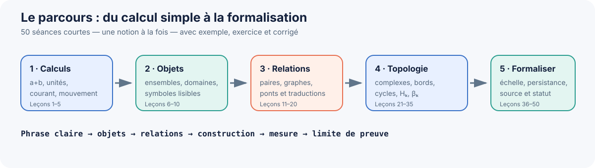
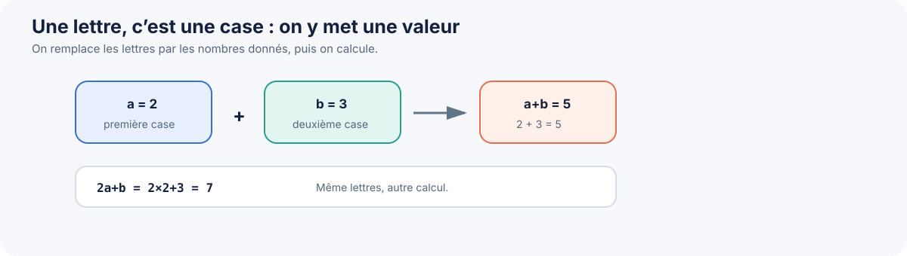
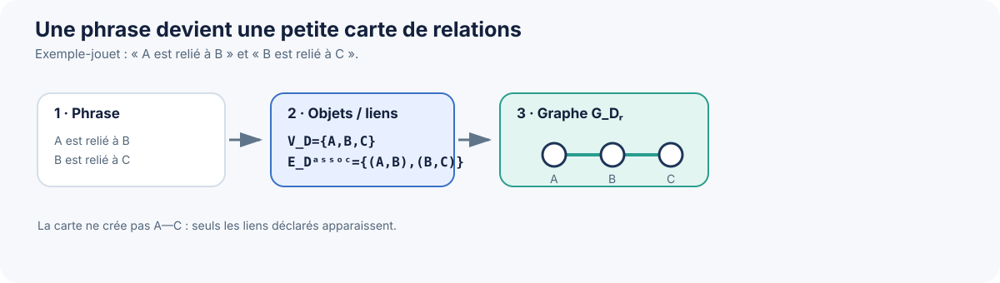
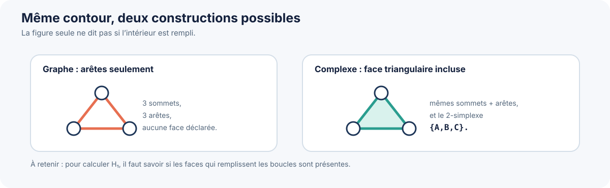
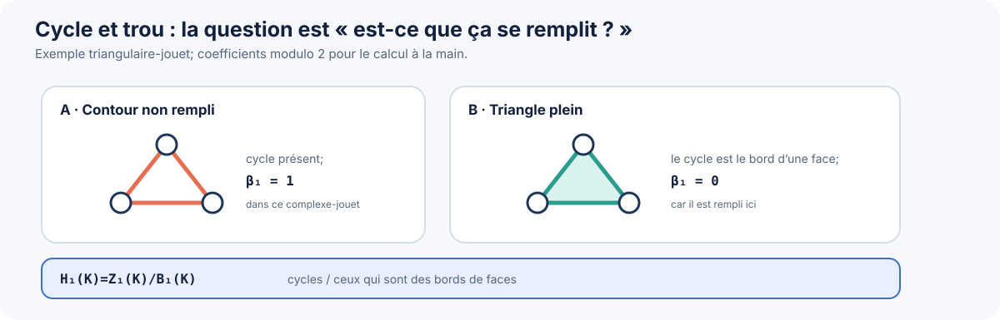
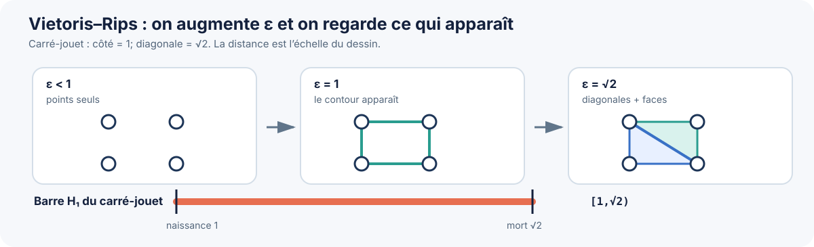
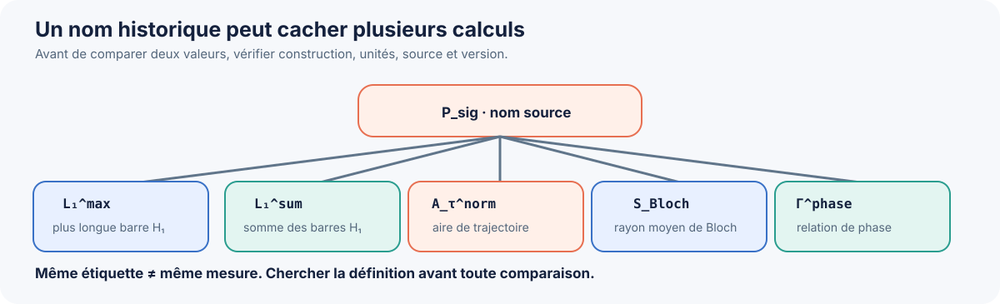
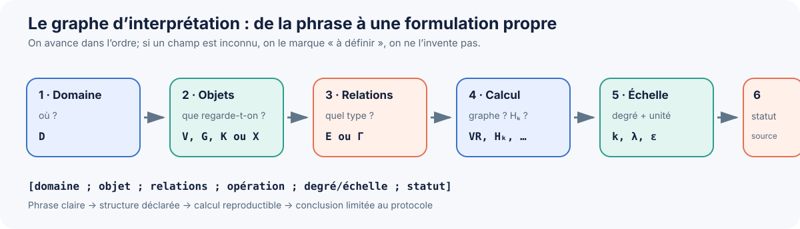

# Cours de maniement du langage topologique RATISS — 50 leçons simples

**Public visé :** débutant en formalisation mathématique. Aucun cours préalable de topologie n’est supposé.
**Format :** 1 leçon courte par séance, 30 minutes maximum.
**But :** passer doucement de `a + b = ...` à la lecture et à la rédaction de formulations déjà présentes dans RATISS.


## Parcours visuel



*Figure 1 — Le parcours complet. Les nombres de leçons indiquent la progression, pas une obligation de vitesse.*

### Navigation rapide

- [Bloc 1 — Calculs de base (1–5)](#bloc-1)
- [Bloc 2 — Objets et ensembles (6–10)](#bloc-2)
- [Bloc 3 — Relations et graphes (11–15)](#bloc-3)
- [Bloc 4 — Ponts et traductions (16–20)](#bloc-4)
- [Bloc 5 — Simplexes et complexes (21–25)](#bloc-5)
- [Bloc 6 — Bord, cycle, homologie (26–30)](#bloc-6)
- [Bloc 7 — Betti et comptages (31–35)](#bloc-7)
- [Bloc 8 — Distances et échelle (36–40)](#bloc-8)
- [Bloc 9 — Persistance et signatures (41–45)](#bloc-9)
- [Bloc 10 — Formalisation RATISS (46–50)](#bloc-10)


> **Important :** le document accepté [00 — Notation transdisciplinaire v0.1](00_NOTATION_TOPOLOGIQUE_TRANSDISCIPLINAIRE_V0_1.md) reste inchangé. Ce cours apprend à la lire et à s’en servir. Les exemples de circuits, de mouvement et les petits nombres sont des exercices pédagogiques, **pas de nouvelles lois RATISS ni des preuves physiques**. On ne donne pas une formule à une nouvelle hypothèse sans travailler d’abord l’hypothèse et sa source.

## Une séance de 30 minutes, sans surcharge

- **3 min — rappel :** relire la dernière carte et dire l’idée à voix haute.
- **7 min — idée du jour :** apprendre une seule chose nouvelle.
- **12 min — exemple guidé :** refaire les calculs lentement, ligne par ligne.
- **6 min — petit exercice :** répondre avant de lire le corrigé.
- **2 min — mémoire :** écrire une phrase « aujourd’hui j’ai compris que… ».

Si tu es fatigué par l’électricité, Arduino, C/C++ ou l’anglais, fais seulement l’exemple et arrête-toi. **Pas de rattrapage punitif, pas besoin d’apprendre toutes les lettres par cœur.** Une leçon peut être refaite plusieurs jours.

### Règles faciles à garder

1. Un symbole est une **étiquette définie**, pas une magie.
2. Toujours demander : « De quel objet parle-t-on ? Dans quel domaine ? »
3. Un graphe ou un calcul dépend de la façon dont on a construit les objets.
4. Une analogie n’est pas une mesure; une mesure n’est pas automatiquement une loi.
5. Une formule bien écrite ne prouve pas à elle seule une affirmation physique.
6. Les mots anglais entre parenthèses sont facultatifs : ils servent seulement à reconnaître le vocabulaire technique.

---

<a id="bloc-1"></a>
# Bloc 1 — Reprendre les bases sans honte (leçons 1 à 5)

## Leçon 1 — Une lettre peut représenter un nombre

**Idée :** `a` et `b` sont des cases dans lesquelles on place des nombres. Ce sont ici des lettres ordinaires d’algèbre, pas de nouveaux symboles RATISS.

**Exemple guidé :** si `a=2` et `b=3`, alors `a+b = 2+3 = 5`. Si `a=5` et `b=1`, alors `a+b=6`. La lettre reste la même; la valeur donnée change.



*Figure 2 — On remplace chaque lettre par sa valeur avant de calculer.*

**À toi :** `a=4`, `b=2`. Calcule `a+b` et `2a+b`.

**Corrigé :** `4+2=6`; `2×4+2=10`.

**Mot anglais facultatif :** *variable* = variable.

## Leçon 2 — Parenthèses et ordre des calculs

**Idée :** on ne calcule pas toujours de gauche à droite. Les parenthèses indiquent le groupe à traiter d’abord; la multiplication passe avant l’addition.

**Exemple guidé :** `2+3×4 = 2+12 = 14`. Mais `(2+3)×4 = 5×4 = 20`. Les parenthèses changent le résultat.

**À toi :** pour `x=3`, calcule `4x−2`.

**Corrigé :** `4×3−2=12−2=10`.

## Leçon 3 — Un calcul avec des unités électriques

**Idée :** un nombre doit garder son unité. Dans un circuit simple, la loi d’Ohm usuelle s’écrit `I=V/R`. C’est une formule d’électricité classique, **pas une notation topologique RATISS**.

**Exemple guidé :** une résistance de `220 Ω` est branchée sous `3,3 V`. Alors `I=3,3/220=0,015 A`. Comme `1 A=1000 mA`, cela donne `15 mA`.

**À toi :** `V=5 V` et `R=1000 Ω`. Calcule `I` en ampères puis en milliampères.

**Corrigé :** `I=5/1000=0,005 A=5 mA`.

**Mot anglais facultatif :** *current* = courant.

## Leçon 4 — Mouvement : distance et vitesse

**Idée :** en mécanique élémentaire, vitesse moyenne = distance parcourue divisée par durée : `v=Δx/Δt`. On vérifie les unités : mètres / secondes = m/s.

**Exemple guidé :** un chariot parcourt `0,6 m` en `0,2 s`. Donc `v=0,6/0,2=3 m/s`.

**À toi :** une roue avance de `2 m` en `4 s`. Quelle est sa vitesse moyenne ?

**Corrigé :** `2/4=0,5 m/s`.

## Leçon 5 — Force : un calcul, pas encore une topologie

**Idée :** la mécanique de base utilise `F=m×a` : force en newtons, masse en kilogrammes, accélération en m/s². Cette relation sert seulement d’exercice de calcul ici.

**Exemple guidé :** `m=0,5 kg`, `a=2 m/s²`. Alors `F=0,5×2=1 N`.

**À toi :** `m=2 kg`, `a=3 m/s²`. Calcule la force.

**Corrigé :** `F=2×3=6 N`.

### Pause de contrôle 1

Sans regarder, peux-tu expliquer : (a) ce que vaut `a+b` si `a=2,b=3`; (b) pourquoi `3,3 V / 220 Ω` donne un courant; (c) ce que mesure `v=Δx/Δt` ? Si non, refais une seule leçon, pas tout le bloc.

---

<a id="bloc-2"></a>
# Bloc 2 — Objets, domaines et relations (leçons 6 à 10)

## Leçon 6 — Une phrase contient des objets et une relation

**Exemple guidé :** dans « le bouton A est relié au voyant B », souligne les objets `A`, `B`; puis le verbe de relation : « est relié à ». La formalisation commence en indiquant **qui** est étudié et **quelle relation** on a réellement choisie. On ne commence pas par `H₁`.

**À toi :** dans « le capteur S envoie une valeur au programme P », quels sont les deux objets et quel est le verbe de relation ?

**Corrigé :** objets `S` et `P`; relation « envoie une valeur à », qui a un sens dirigé.

## Leçon 7 — Un ensemble et ses éléments

**Idée :** un ensemble est une collection dont on sait dire si un élément est dedans ou non. `∈` se lit « appartient à ».

**Exemple guidé :** `V_D={A,B,C}`. Alors `A∈V_D` est vrai et `Z∈V_D` est faux. Ici `V_D` est l’ensemble des objets choisis pour le domaine `D`.

**À toi :** si `V_D={R1,R2,LED}`, est-ce que `R2∈V_D` ?

**Corrigé :** oui.

**Mot anglais facultatif :** *set* = ensemble.

## Leçon 8 — Compter les éléments d’un ensemble

**Idée :** les doublons ne créent pas un nouvel élément dans un ensemble.

**Exemple guidé :** `{A,B,A}` représente le même ensemble que `{A,B}`. Il y a donc 2 éléments, pas 3. En écriture ordinaire, `|{A,B}|=2` signifie « le nombre d’éléments vaut 2 ».

**À toi :** combien d’éléments dans `{R1,R2,R1,LED}` ?

**Corrigé :** 3 : `R1`, `R2`, `LED`.

## Leçon 9 — L’indice `D` répond à « dans quel domaine ? »

**Idée :** dans `V_D`, le petit `D` est une étiquette de contexte. Il ne faut pas l’effacer si le domaine compte.

**Exemple guidé :** si `D=électronique`, `V_D` peut contenir des composants du circuit. Si `D=mécanique`, `V_D` peut contenir des pièces d’un mécanisme. La lettre `V` reste la même, mais les objets changent avec `D`.

**À toi :** donne un exemple de deux objets pour `V_D` si `D=Arduino`.

**Corrigé possible :** une broche et un capteur; d’autres réponses correctes existent si les objets sont définis clairement.

## Leçon 10 — Lire une ligne entière du dictionnaire

`G_D^r=(V_D,E_D^r)` se lit : « dans le domaine `D`, je construis le graphe de type de relation `r`; ses objets sont `V_D` et ses liens sont `E_D^r` ».

**Exemple guidé :** `D=électronique`; `V_D={A,B,C}`; les liens de connexion choisis sont entre `A` et `B`, puis `B` et `C`. Le graphe garde ces objets et ces liens, pas toute l’histoire de l’appareil.

**À toi :** dans la formule, quelle partie donne les objets et quelle partie donne les liens ?

**Corrigé :** `V_D` donne les objets; `E_D^r` donne les relations.

---

<a id="bloc-3"></a>
# Bloc 3 — Relations et graphes (leçons 11 à 15)



*Figure 3 — Le graphe ne contient que les liens déclarés dans la phrase.*

## Leçon 11 — Une relation peut s’écrire comme une liste de paires

**Idée :** une arête ordinaire relie deux objets. Pour une association non orientée, on peut retenir les paires sans donner de sens « départ-arrivée ».

**Exemple guidé :** `V_D={A,B,C}` et `E_D^assoc={(A,B),(B,C)}`. Cela dit que A est associé à B et B à C. Cela ne déclare pas de lien A–C.

**À toi :** si `E_D^assoc={(A,B),(B,C),(C,D)}`, combien de liens as-tu listés ?

**Corrigé :** 3.

## Leçon 12 — Une flèche n’est pas la même chose qu’un simple lien

**Idée :** une succession est dirigée. `E_D^seq` indique « ensuite », « transmet à », ou une autre relation orientée définie.

**Exemple guidé :** `E_D^seq={(A,B),(B,C)}` signifie A précède B, puis B précède C. Cela ne donne pas automatiquement `(B,A)` ou `(C,B)`.

**À toi :** si un message passe de Arduino à l’ordinateur puis au journal d’événements, écris les deux paires de succession avec `Arduino`, `PC`, `Journal`.

**Corrigé :** `(Arduino,PC)` et `(PC,Journal)`.

**Mot anglais facultatif :** *directed edge* = arête orientée.

## Leçon 13 — Construire un petit graphe `G_D^r`

**Exemple guidé :** `V_D={A,B,C,D}`; `E_D^assoc={(A,B),(B,C),(C,D)}`. Il y a 4 sommets et 3 arêtes. Une représentation possible est `A—B—C—D`.

**Attention :** le dessin est un moyen de voir les relations; il n’ajoute pas de lien entre A et D.

**À toi :** retire `(B,C)`. Quels liens restent ?

**Corrigé :** `(A,B)` et `(C,D)`.

## Leçon 14 — Chemin dans un graphe

`Path_G(u,v)` désigne les chemins de `u` à `v` dans le graphe choisi. Un chemin suit des liens présents; il ne peut pas inventer une arête.

**Exemple guidé :** dans `A—B—C—D`, un chemin de A à D est `A→B→C→D`. Il passe par 3 arêtes.

**À toi :** y a-t-il un chemin de A à D après avoir retiré `(B,C)` ?

**Corrigé :** non, la coupure sépare les deux morceaux.

**Mot anglais facultatif :** *path* = chemin.

## Leçon 15 — Composantes : combien de morceaux séparés ?

**Exemple guidé :** `V={A,B,C,D}`, `E={(A,B),(B,C)}`. A, B et C sont reliés entre eux; D est isolé. Le graphe contient donc 2 composantes : `{A,B,C}` et `{D}`.

**À toi :** si on ajoute `(C,D)`, combien de composantes restent ?

**Corrigé :** 1, car les quatre sommets sont alors reliés.

---

<a id="bloc-4"></a>
# Bloc 4 — Relier des domaines et traduire (leçons 16 à 20)

## Leçon 16 — Distinguer analogie et relation observée

Le dictionnaire distingue les types de ponts. `Γ_AB^ana` signifie que l’on propose une **analogie** entre A et B. `Γ_AB^obs` désigne une relation rapportée comme observée ou mesurée selon un protocole. Ce ne sont pas les mêmes niveaux d’appui.

**Exemple guidé :** comparer une carte de circuit et une carte de métro peut être une analogie. Une mesure synchronisée entre deux capteurs est une observation seulement si le protocole et les données sont décrits.

**À toi :** « ces deux dessins se ressemblent » : analogie ou mesure ?

**Corrigé :** analogie (`ana`), pas mesure.

## Leçon 17 — `Γ_AB^r` est un pont entre deux domaines

`Γ_AB^r` sert à décrire des relations entre une couche A et une couche B. L’indice `r` précise le type du pont; par exemple `ana` pour une analogie et `obs` pour une relation observée selon des données.

**Exemple guidé :** A = sorties d’un capteur; B = événements enregistrés par un programme. Si une correspondance est simplement proposée, elle n’est pas encore un pont observé. Il faut dire comment les événements ont été associés aux mesures.

**À toi :** que dois-tu préciser avant d’écrire un pont entre deux domaines ?

**Corrigé :** les objets de chaque domaine, le type du lien et la manière de l’établir.

## Leçon 18 — `f_AB` est une règle de traduction

`f_AB:K_A→K_B` signifie qu’une application structurale transforme l’objet construit en A en un objet de B, selon une règle déclarée. La flèche ne signifie pas « A cause B ».

**Exemple guidé :** une règle de conversion prend chaque code numérique reçu par un programme et lui associe une étiquette `LOW` ou `HIGH`. Pour écrire `f_AB`, il faut dire comment chaque entrée est traduite.

**À toi :** si `0→LOW` et `1→HIGH`, que devient l’entrée `1` sous la règle ?

**Corrigé :** `HIGH`.

## Leçon 19 — Appliquer deux traductions à la suite

Si `f_AB` traduit A vers B et `f_BC` traduit B vers C, `f_BC∘f_AB` signifie : d’abord `f_AB`, puis `f_BC`.

**Exemple guidé :** nombre `1` → mot `un` → mot anglais `one`. On obtient `one`. On ne peut pas appliquer la seconde règle avant d’avoir obtenu son entrée en B.

**À toi :** avec `A→B→C`, dans quel ordre lis-tu `f_BC∘f_AB` ?

**Corrigé :** de droite à gauche dans l’écriture : `f_AB` d’abord, puis `f_BC`.

## Leçon 20 — Lire une formule de complexe joint sans paniquer

La notation acceptée donne : `K_(A⋈B)=Cl(K_A ⊔ K_B ∪ Γ_AB^r)`. Pour l’instant, lis-la comme une recette : prendre A et B séparément, ajouter le pont déclaré, puis fermer le résultat pour obtenir un complexe valide. On détaillera `Cl` et les faces aux leçons 21–24.

**Exemple guidé :** `K_A` contient deux objets, `K_B` en contient un, et un lien déclaré relie un objet de A à celui de B. Le complexe joint garde les trois objets et inclut ce lien; il ne prouve pas à lui seul une loi commune.

**À toi :** la recette comprend-elle une étape « prouver que la physique est vraie » ?

**Corrigé :** non. La formule décrit la construction mathématique, pas le statut de preuve.

---

<a id="bloc-5"></a>
# Bloc 5 — Graphes, simplexes et complexes (leçons 21 à 25)



*Figure 4 — Un contour dessiné ne signifie pas automatiquement que son intérieur est une face.*

## Leçon 21 — Graphe et complexe simplicial : pas synonymes

Un graphe relie des objets par paires. Un complexe simplicial peut aussi dire que trois objets sont réunis dans une face triangulaire, ou plus généralement qu’un groupe entier constitue un simplexe.

**Exemple guidé :** trois arêtes `A—B—C—A` forment un contour. Si l’intérieur est déclaré rempli par un 2-simplexe, ce contour est le bord d’une face. Même dessin extérieur, structure mathématique différente.

**À toi :** un dessin de triangle indique-t-il automatiquement que son intérieur est rempli ?

**Corrigé :** non. La construction doit le dire.

## Leçon 22 — Sommets, arêtes, triangle : compter la dimension

Un simplexe à un sommet est de dimension 0; une arête à deux sommets, de dimension 1; un triangle plein à trois sommets, de dimension 2.

**Exemple guidé :** `{A,B,C}` est un 2-simplexe. Ses faces sont les arêtes `{A,B}`, `{B,C}`, `{A,C}` et les sommets `{A}`, `{B}`, `{C}`.

**À toi :** quelle est la dimension de `{A,B}` ?

**Corrigé :** 1.

**Mot anglais facultatif :** *simplex* = simplexe.

## Leçon 23 — Lire `K_D=(V_D,Σ_D)`

`V_D` contient les sommets/objets; `Σ_D` contient les simplexes déclarés et leurs faces. Pour que `K_D` soit un complexe simplicial, les faces des simplexes doivent aussi y être présentes.

**Exemple guidé :** si `Σ_D` contient le triangle `{A,B,C}`, il faut aussi y trouver ses trois arêtes et ses trois sommets.

**À toi :** si le triangle est déclaré mais qu’il manque l’arête `{A,C}`, le complexe est-il complet selon la règle des faces ?

**Corrigé :** non.

## Leçon 24 — `Cl(S)` ajoute les faces manquantes

`Cl(S)` est la fermeture simpliciale. Elle complète les faces nécessaires après l’ajout de simplexes.

**Exemple guidé :** si `S` contient seulement `{A,B,C}`, `Cl(S)` ajoute `{A,B}`, `{B,C}`, `{A,C}`, puis `{A}`, `{B}`, `{C}`. Dans ce cours, on ne s’occupe pas de la convention facultative sur la face vide.

**À toi :** quelles faces manquent si `S` contient seulement `{A,B}` ?

**Corrigé :** `{A}` et `{B}`.

## Leçon 25 — Les degrés `0`, `1`, `2` parlent de la structure construite

Dans les exemples usuels, `H₀/β₀` décrit les composantes, `H₁/β₁` les boucles indépendantes, `H₂/β₂` des cavités ou enveloppes. Le sens dépend toujours du complexe construit.

**Exemple guidé :** un carré fait seulement de quatre arêtes a un contour non rempli. Si on ajoute deux triangles qui remplissent l’intérieur, le contour se remplit. Le calcul H1 change parce que le complexe a changé.

**À toi :** le seul dessin suffit-il à déterminer `β₁` ?

**Corrigé :** non. Il faut savoir quelles arêtes et quelles faces sont incluses.

---

<a id="bloc-6"></a>
# Bloc 6 — Bord, cycle et homologie (leçons 26 à 30)



*Figure 5 — Dans le modèle-jouet, remplir la face change la classe H1.*

## Leçon 26 — Une chaîne est une combinaison de simplexes

`Ch_k(K)` désigne les chaînes de dimension `k`. Pour calculer à la main, on choisit ici des coefficients modulo 2 (`F₂`) : une arête apparaît ou n’apparaît pas; deux copies de la même arête s’annulent. C’est un choix pédagogique courant, pas une nouvelle règle RATISS universelle.

**Exemple guidé :** `z=[A,B]+[B,C]+[C,A]` est une chaîne de dimension 1 formée des trois arêtes d’un triangle.

**À toi :** cette chaîne contient combien d’arêtes ?

**Corrigé :** 3.

## Leçon 27 — Le bord d’une arête

`∂₁` envoie une arête vers ses deux extrémités. En coefficients modulo 2 : `∂₁[A,B]=[A]+[B]`.

**Exemple guidé :** les extrémités de `[B,C]` sont B et C. Donc `∂₁[B,C]=[B]+[C]`.

**À toi :** quel est le bord de `[A,C]` ?

**Corrigé :** `[A]+[C]`.

**Mot anglais facultatif :** *boundary* = bord.

## Leçon 28 — Le bord d’un triangle et « le bord du bord »

En modulo 2, `∂₂[A,B,C]=[A,B]+[B,C]+[C,A]`.

**Exemple guidé — calcul :** appliquer ensuite `∂₁` donne `(A+B)+(B+C)+(C+A)`. Chaque sommet apparaît deux fois; modulo 2, les doubles s’annulent. Résultat : 0. C’est l’idée derrière « le bord d’un bord est nul ».

**À toi :** si un sommet apparaît deux fois dans ce calcul modulo 2, que devient-il ?

**Corrigé :** il s’annule.

## Leçon 29 — Un cycle n’a pas de bord

`Z_k(K)=ker ∂_k` désigne les chaînes dont le bord est nul. Une forme visuellement fermée est un bon indice, mais le calcul avec `∂` décide.

**Exemple guidé :** les trois arêtes d’un triangle fermé donnent chaque sommet deux fois au bord total; modulo 2, la somme vaut 0. Cette chaîne est donc un cycle.

**À toi :** une seule arête isolée `[A,B]` est-elle un cycle ?

**Corrigé :** non, son bord `A+B` n’est pas nul.

## Leçon 30 — Un cycle peut être le bord d’une surface

`B_k(K)=im ∂_(k+1)` désigne les chaînes qui sont des bords de simplexes de dimension supérieure. `H_k(K)=Z_k(K)/B_k(K)` compare les cycles en identifiant ceux qui se remplissent.

**Exemple guidé :** si le triangle plein `{A,B,C}` est dans le complexe, le contour de ses trois arêtes est le bord du triangle : il appartient à `B₁`. Si le triangle n’est pas rempli, ce contour n’est pas le bord d’une face dans ce complexe.

**À toi :** quel ingrédient manque pour dire que le contour est rempli ?

**Corrigé :** le 2-simplexe triangulaire.

---

<a id="bloc-7"></a>
# Bloc 7 — Nombres de Betti et comptages (leçons 31 à 35)

## Leçon 31 — `β₀` : compter les composantes

`β₀(K)=rank H₀(K)`; dans les petits exemples, on peut le lire comme le nombre de morceaux connectés.

**Exemple guidé :** `{A,B}` reliés, `{C}` isolé, `{D}` isolé : il y a 3 composantes, donc `β₀=3`.

**À toi :** si on relie C à D, combien de composantes restent ?

**Corrigé :** 2 : `{A,B}` et `{C,D}`.

## Leçon 32 — `β₁` : compter des boucles indépendantes dans un exemple simple

Considérons un graphe sans faces de dimension 2. Un carré simple contient un contour indépendant : `β₁=1`.

**Exemple guidé — calcul :** quatre arêtes forment le carré et les sommets sont connectés. Si l’on traite ce graphe comme un complexe uniquement de dimension 1, son seul cycle indépendant donne `β₁=1`.

**À toi :** si on ajoute une diagonale mais qu’on ne remplit aucune face, le graphe gagne-t-il une autre boucle indépendante ?

**Corrigé :** oui, dans ce graphe 1D, la diagonale découpe deux cycles indépendants; `β₁=2`.

## Leçon 33 — Remplir une boucle change `H₁`

**Exemple guidé :** un carré seul a `β₁=1`. Si on ajoute une diagonale, puis les deux triangles qui remplissent le carré, les boucles dessinées sont maintenant des bords de faces. Le résultat homologique n’est donc pas celui du graphe sans faces.

**À toi :** pourquoi faut-il préciser les triangles, et pas seulement les arêtes ?

**Corrigé :** parce que les 2-simplexes peuvent remplir des cycles et changer `H₁`.

## Leçon 34 — `β₂` : une cavité dans un modèle 3D

**Image mentale :** la surface d’un ballon vide, modélisée par ses faces, peut entourer une cavité; remplir aussi l’intérieur par un 3-simplexe enlève cette cavité dans le complexe.

**Exemple guidé :** la frontière triangulée d’un tétraèdre, sans tétraèdre plein, a une cavité de degré 2 dans ce modèle. Si le tétraèdre plein est ajouté, cette cavité est remplie.

**À toi :** un dessin de ballon suffit-il à prouver qu’une cavité est présente dans les données ?

**Corrigé :** non. Il faut définir les points, les faces et les règles de construction.

## Leçon 35 — Caractéristique d’Euler : un contrôle de calcul

`χ(K)=Σ_k(−1)^kβ_k(K)`. Sur un complexe de dimension 2, cela devient `β₀−β₁+β₂`.

**Exemple guidé, triangle plein :** 3 sommets, 3 arêtes, 1 face; la formule par simplexes donne `3−3+1=1`. Les Betti sont `β₀=1`, `β₁=0`, `β₂=0`, donc `1−0+0=1` aussi.

**À toi :** pour un contour triangulaire non rempli, `β₀=1`, `β₁=1`, `β₂=0`. Calcule `χ`.

**Corrigé :** `1−1+0=0`.

---

<a id="bloc-8"></a>
# Bloc 8 — Points, distances, mécanique et échelle (leçons 36 à 40)



*Figure 6 — Quand l’échelle augmente, une boucle peut apparaître puis se remplir.*

## Leçon 36 — Un nuage `X_D` a besoin d’une distance

`X_D` peut représenter un espace ou un nuage de points muni d’une distance. Une distance n’est pas un lien arbitraire : elle se calcule selon une règle déclarée.

**Exemple guidé :** points `P=(0,0)` et `Q=(3,4)`. Distance euclidienne : `√((3−0)²+(4−0)²)=√(9+16)=√25=5`.

**À toi :** quelle est la distance entre `(0,0)` et `(0,6)` ?

**Corrigé :** `6`.

## Leçon 37 — Construire `VR_ε(X)` avec un seuil

Dans un complexe de Vietoris–Rips, on relie deux points si leur distance est au plus `ε`. Un groupe devient un simplexe si toutes les distances entre ses points respectent le seuil.

**Exemple guidé :** trois points dont les distances valent 3, 4 et 5. À `ε=3`, seule la paire à distance 3 est reliée. Il n’y a pas de triangle plein.

**À toi :** à `ε=4`, combien de paires sont reliées ?

**Corrigé :** 2 : celles aux distances 3 et 4.

## Leçon 38 — `ε` est une échelle, avec une unité

`VR_ε(X)` dépend du seuil `ε`. Si les distances sont en mètres, `ε` est donné en mètres. À seuil plus grand, on peut ajouter des liens; il ne faut pas oublier l’unité.

**Exemple guidé :** avec les distances 3 m, 4 m, 5 m : à `ε=4 m`, deux liens; à `ε=5 m`, trois liens et le triangle est rempli dans le VR.

**À toi :** si les distances sont mesurées en centimètres, écris l’unité de `ε=4`.

**Corrigé :** `ε=4 cm`.

## Leçon 39 — Une filtration est une suite emboîtée

`K^λ₁⊆K^λ₂` lorsque `λ₁≤λ₂`. Pour Vietoris–Rips, augmenter `ε` ajoute progressivement des liens et des simplexes.

**Exemple guidé :** sur un carré de côté 1 et diagonale `√2`, à `ε<1` les côtés n’apparaissent pas; à `ε=1` le contour se forme; à `ε=√2` les diagonales apparaissent et les faces triangulaires remplissent le cycle.

**À toi :** quand `ε` augmente, la filtration retire-t-elle d’abord des arêtes ou en ajoute-t-elle ?

**Corrigé :** elle en ajoute; elle est croissante.

**Mot anglais facultatif :** *filtration* = filtration.

## Leçon 40 — Naissance et disparition d’une boucle

Dans l’exemple du carré de la leçon 39, la boucle apparaît quand les côtés sont là (`ε=1`) et disparaît quand les diagonales la remplissent (`ε=√2`). Son intervalle s’écrit `[1,√2)`.

**Exemple guidé :** le crochet `[` inclut la naissance; la parenthèse `)` exclut le seuil de disparition. La boucle est présente pour `1≤ε<√2`.

**À toi :** la boucle est-elle présente à `ε=1,2` ? Et à `ε=1,5` ?

**Corrigé :** oui à `1,2`; non à `1,5` car `1,5>√2≈1,414`.

---

<a id="bloc-9"></a>
# Bloc 9 — Persistance et signatures voisines (leçons 41 à 45)

## Leçon 41 — Calculer une durée de persistance

Pour l’intervalle `I_j^k=[b_j,d_j)`, sa longueur est `ℓ_j^k=d_j−b_j`.

**Exemple guidé :** `[1,√2)` a une longueur `√2−1≈1,414−1=0,414`. Si l’échelle est en mètres, la longueur a aussi une unité de mètres.

**À toi :** quelle est la longueur de `[2,5)` ?

**Corrigé :** `5−2=3` unités d’échelle.

## Leçon 42 — `L^max` et `L^sum` répondent à deux questions

`L_k^max` demande « quelle est la plus longue barre finie ? »; `L_k^sum` demande « quelle est la somme des longueurs finies ? ».

**Exemple guidé :** barres `[1,3)` et `[2,4,5)`. Durées : `2` et `2,5`. Donc `L^max=2,5` et `L^sum=2+2,5=4,5`.

**À toi :** avec deux durées 1 et 7, que vaut `L^max` et `L^sum` ?

**Corrigé :** `L^max=7`; `L^sum=8`.

## Leçon 43 — Un Betti à un niveau n’est pas le nombre total de barres

`β_k(K^λ)` compte les classes présentes à **un niveau choisi**. `N_{k,fin}^{bars}` compte les intervalles finis sur **tout le diagramme**. Les questions sont différentes.

**Exemple guidé :** deux barres H1 : `[1,2)` et `[4,6)`. À `λ=1,5`, `β₁=1`; sur le diagramme complet, il y a 2 barres finies.

**À toi :** à `λ=3`, combien de ces barres sont présentes ?

**Corrigé :** aucune; `β₁(K^3)=0`, même si le diagramme garde ses deux barres finies.

## Leçon 44 — Tout ce qui porte le mot « topo » n’est pas H1

Le dictionnaire sépare notamment : `A_τ^norm(s)` (aire de trajectoire retardée), `Hol_γ` (phase géométrique), `Sync(…)` (accord entre couches), `S_Bloch` (rayon de Bloch), `N_vort^gate` (vortex locaux), `Path_G` (chemins), et les groupes `H_k`.

**Exemple guidé :** calculer l’aire d’une trajectoire n’est pas calculer `H₁`; compter un vortex n’est pas compter `β₁`; trouver un chemin n’est pas calculer une persistance.

**À toi :** le chemin le plus court dans un graphe est-il automatiquement une barre H1 ?

**Corrigé :** non.

## Leçon 45 — Pourquoi `P_sig` demande toujours une question



*Figure 7 — Avant de comparer deux valeurs, vérifier le calcul canonique réellement utilisé.*

`P_sig` est un nom historique rencontré dans plusieurs sources, mais ses constructions diffèrent. Selon le dépôt, il peut désigner une persistance H1 maximale, une somme H1/H2, une aire de trajectoire, un rayon de Bloch ou autre chose.

**Exemple guidé :** deux dépôts affichent tous deux `P_sig=0,8`. Le premier calcule `L₁^max`, le second `A_τ^norm`. Même nombre, mais deux opérations différentes : on ne les compare pas comme une mesure identique.

**Méthode en trois questions :** (1) quelle donnée entre ? (2) quelle opération exacte est calculée ? (3) quelles unités et quel dépôt/version ? Ensuite seulement, on choisit le nom canonique correspondant dans [03 — Signatures](03_SIGNATURES.md).

**À toi :** deux nombres nommés `P_sig` sont-ils comparables simplement parce qu’ils ont le même nom ?

**Corrigé :** non, il faut d’abord vérifier que construction, unité et protocole sont les mêmes.

---

<a id="bloc-10"></a>
# Bloc 10 — Passer d’une phrase à une formalisation RATISS (leçons 46 à 50)



*Figure 8 — Si une étape est inconnue, l’indiquer « à définir » plutôt que l’inventer.*

## Leçon 46 — La fiche de formalisation en six cases

La grammaire du dictionnaire se lit :

```text
[domaine ; objet ; relations ; opération topologique ; degré/échelle ; statut]
```

Pour étudier une source, ajoute aussi la provenance : dépôt/fichier/version, données, construction, mesure et limite. C’est une fiche de travail, pas une nouvelle équation.

**Exemple guidé :** pour un graphe de capteurs : `domaine=réseau`, `objet=graphe déclaré`, `relations=associations mesurées`, `opération=à définir selon la question`, `degré/échelle=à préciser`, `statut=code` si le calcul existe dans un programme seulement.

**À toi :** quel champ manque si tu écris seulement « β1 vaut 1 » ?

**Corrigé :** au minimum le complexe, la construction, le degré/contexte et le statut; il faut savoir quel objet a été calculé.

## Leçon 47 — Formaliser un transfert représenté

Phrase acceptée en v0.1 : « au moins une structure de degré `k` de A a une image non nulle dans B ». On déclare `f_AB`, puis on regarde l’application induite `H_k(f_AB)`.

**Écriture :** `rank im(H_k(f_AB))>0`.

**Exemple guidé :** dans un modèle-jouet, la source a une boucle et la règle `f_AB` l’envoie vers une boucle du modèle cible; l’image a rang 1, donc la condition est satisfaite dans ce jouet. Cela ne prouve pas que la traduction existe dans un système réel.

**À toi :** si l’image ne contient aucune classe, `rank im` vaut quoi ?

**Corrigé :** 0; la condition « au moins une classe passe » n’est pas satisfaite.

## Leçon 48 — « Rien n’est perdu » n’est pas « c’est identique »

`ker(H_k(f_AB))={0}` signifie qu’aucune classe de degré `k` de A n’est envoyée à zéro par cette application. `H_k(K_A)≅H_k(K_B)` dit que les groupes sont isomorphes au degré choisi. C’est une autre affirmation; aucune des deux ne prouve l’identité physique des systèmes.

**Exemple guidé :** une application mathématique peut envoyer `n` vers `(n,0)`. Son noyau est zéro, mais son groupe cible peut avoir une deuxième direction supplémentaire. L’application ne perd pas les éléments de départ, pourtant les deux groupes ne sont pas forcément isomorphes.

**À toi :** « aucune classe de A n’est perdue » et « A et B sont identiques » veulent-ils dire la même chose ?

**Corrigé :** non.

## Leçon 49 — Lire une formulation RATISS déjà existante : LCT

Dans les formulations consultées, la version finale d’ODV-AEON écrit `R=P_sig`; le calcul ciblé définit la signature comme la persistance H1 finie maximale. La traduction documentée est `R_LCT:=L₁^max(K_TTF)` lorsqu’on parle bien de ce calcul et de ce complexe. Voir [04 — Formulations existantes](04_FORMULATIONS_EXISTANTES.md).

**Exemple guidé — calcul-jouet, non résultat source :** si le diagramme d’entraînement a des durées finies `0,2`, `0,6`, `0,4`, alors `L₁^max=0,6` (dans l’unité de l’échelle). Les nombres servent seulement à apprendre le maximum; ils ne sont pas les résultats d’une expérience RATISS.

**À toi :** la notation permet-elle de conclure que la règle LCT est une loi physique universelle ?

**Corrigé :** non. Elle traduit la quantité et le statut de la formulation; les preuves et limites restent celles du protocole source.

## Leçon 50 — Projet final : formaliser sans inventer

**Exemple guidé — projet à partir d’une formulation RATISS-SSH existante** dans [04 — Formulations existantes, A2](04_FORMULATIONS_EXISTANTES.md) : la source rapporte un contraste de `L₁^max` entre un cas trivial et un cas topologique dans son modèle SSH.

Complète la fiche :

1. **Source/version :** dépôt et fichier de calcul indiqués dans le document source.
2. **Objets :** profils de corrélation `c_i` et distances `D_ij` décrits par la source.
3. **Construction :** complexe de Vietoris–Rips `K_SSH=VR(D)`.
4. **Mesure :** `L₁^max(K_SSH)`, pas `β₁` et pas un vague `P_sig`.
5. **Phrase source :** la source rapporte `L₁^max=0` du côté trivial et une valeur non nulle du côté dit topologique, dans son périmètre d’essai.
6. **Statut/limite :** résultat rapporté par la source; une notation ne le reproduit pas et ne le généralise pas à toute la physique.
7. **Question qui pourrait le mettre en défaut :** avec le même protocole, le contraste annoncé persiste-t-il sur des données ou paramètres de test indépendants ?

**Corrigé attendu :** tu n’inventes pas une nouvelle équation. Tu as identifié le nuage, la distance, le complexe, la signature, le contraste rapporté et la limite de preuve. C’est déjà une bonne formalisation.

---

# Carte de poche — les questions à se poser à chaque fois

1. **Quels sont les objets ?** `V_D`, `G_D`, `K_D` ou `X_D` ?
2. **Quel type de lien ?** association, succession, analogie, représentation, mesure/observation ?
3. **Quel calcul exact ?** graphe, complexe, `H_k`, `β_k`, persistance, aire ou phase ?
4. **Quelle échelle et quelle unité ?** en particulier pour `λ`, `ε`, `b`, `d`.
5. **Quelle source et quel statut ?** idée, hypothèse, spécification, code, simulation, test, observation ?
6. **Qu’est-ce qui pourrait montrer que la phrase est fausse ?**

## Petit dictionnaire anglais facultatif

| English | Français |
|---|---|
| variable | variable |
| set | ensemble |
| element | élément |
| relation | relation |
| vertex / node | sommet / nœud |
| edge | arête |
| path | chemin |
| simplex | simplexe |
| face | face |
| boundary | bord |
| cycle | cycle |
| hole | trou |
| filtration | filtration |
| persistence | persistance |
| evidence | élément de preuve / appui |
| hypothesis | hypothèse |

**Tu peux commencer par la leçon 1 et t’arrêter après 30 minutes.** Le but n’est pas de finir vite; le but est de pouvoir expliquer avec tes mots ce que chaque symbole représente et ce qu’il ne permet pas de conclure.


## Représentation textuelle de secours

Si ton lecteur Markdown ne montre pas les figures, garde cette chaîne comme carte mentale :

```text
phrase / données
      ↓
objets V_D  →  relations E_D^r ou Γ_AB^r
      ↓
G_D (graphe) ou K_D (complexe), ou X_D (nuage avec distance)
      ↓
construction déclarée (par exemple VR_ε), puis H_k / β_k / diagramme de persistance
      ↓
mesure typée + échelle/unité + source/version + statut + limite
```

Ce schéma est un outil d’interprétation. Il ne transforme pas une analogie en mesure, ni un résultat de code ou de simulation en preuve physique.
